  

  
  
  

 

## About

I'm **Md. Estiak Rahman Ayon**, a Computer Science and Engineering graduate from American International University-Bangladesh (AIUB). I work across AI/ML, MLOps and software engineering, with a focus on making models useful under real constraints: low-resource languages, limited compute and production pipelines that are easy to maintain. Alongside ML work, I build full-stack web applications, from backend logic to the interfaces people use.

This repository holds my personal portfolio. It brings together my experience, projects, research, skills, education, certificates and volunteering in one place.

 

## Focus Areas

- **Resource-efficient AI** for low-resource languages and limited hardware
- **Vision-language models** for medical report generation
- **MLOps**: reproducible training, deployment and monitoring pipelines
- **Practical software engineering** for shipping ML into real products

 

## Education

**BSc in Computer Science and Engineering**, major in Information Systems 
American International University-Bangladesh (AIUB) · 2022 – 2026

 

## Get in Touch

The best way to reach me is through the contact section of the [live portfolio](https://estkayon.github.io/Portfolio/) or on [LinkedIn](https://www.linkedin.com/in/md-estiak-rahman-ayon/).

 

  © 2026 Md. Estiak Rahman Ayon. All rights reserved.

